# PushMe - Android 消息通知客户端

<p align="center">
  <strong>简单 · 轻量 · 支持插件 · 可自部署</strong>
</p>

<p align="center">
  <a href="https://github.com/yafoo/pushme/releases/latest">
    
  </a>
  <a href="https://github.com/yafoo/pushme">
    
  </a>
  <a href="https://github.com/yafoo/pushme/blob/master/LICENSE">
    
  </a>
  <a href="https://t.me/pushme_channel">
    
  </a>
  <a href="./assets/wechat-group.jpg?v=3">
    
  </a>
</p>

<p align="center">
  <a href="https://push.i-i.me">官网</a> ·
  <a href="https://github.com/yafoo/pushme-plugin">插件仓库</a>
</p>

> PushMe is a lightweight Android push notification client built on MQTT.
> The UI and documentation are in Chinese; code comments are in Chinese as well.

---

## 📱 项目简介

PushMe 是一款专为 Android 设计的轻量级消息通知客户端。通过 MQTT 长连接实时接收服务端推送的消息，并以通知、悬浮窗、图表等形式展示，帮助你及时接收各类推送消息。

### ✨ 核心特性

**消息能力**

- **实时接收**：MQTT 长连接 + 前台服务，掉线自动重连
- **多种消息类型**：`text`、`markdown`、`html`、`url`、`data`、`markdata`、`chart`、`echarts`、`svg`、`note`
- **悬浮窗消息**：重要消息以悬浮窗展示
- **TTS 语音播报**
- **消息转发**：把收到的消息以 HTTP POST 转发到指定地址

**扩展能力**

- **🔌 消息插件**：内置 QuickJS 引擎，用 JavaScript 处理消息（加解密、转发、改写、条件过滤等）
- **插件商店**：从远程索引浏览、安装、更新插件，带 sha256 校验
- **通知监听转发**：把其它应用的通知按规则转发到服务端
- **定时任务**：cron 表达式驱动，到点自动发送消息
- **本地 API 服务**：应用内启动 HTTP 服务，接口兼容官方协议，便于局域网内其它设备推送

**部署与运行**

- **🏠 自部署服务**：支持把 MQTT 与 API 地址指向自己部署的服务端，数据完全掌控
- **⚡ 轻量高效**：资源占用低，后台运行稳定
- **📲 广泛兼容**：支持 Android 7.0 及以上版本
- **🔔 状态监控**：提供 StateChannel 通道，实时查看服务在线状态

---

## 🏗️ 系统架构

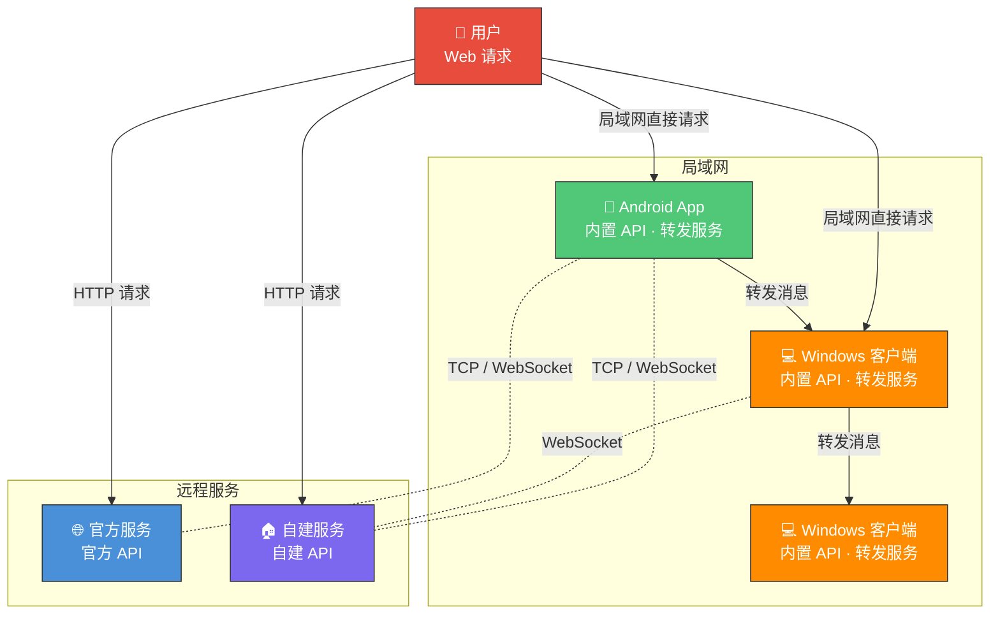

> 🔗 **统一 API 接口**：官方服务、自建服务、App API、Windows API 接口规范完全一致
>
> 📡 **消息路径**：
> - **用户发起**：用户通过 Web 请求官方 API、自建服务 API，或局域网直接请求 App/Win API
> - **远程推送**：消息通过 App 与官方服务/自建服务的 TCP/WebSocket 连接传输至手机
> - **局域网直达**：通过局域网 IP 直接调用 App API 或 Win API，消息直达设备
> - **消息转发**：手机可将消息转发至局域网内的 Windows 客户端
> - **链式转发**：Windows 客户端之间可互相转发消息
> - **后台连接**：App 与官方服务/自建服务保持 TCP/WebSocket 长连接；Windows 客户端可连接自建服务（WebSocket）

---

## 🖼️ 应用预览

<table>
  <tr>
    <td>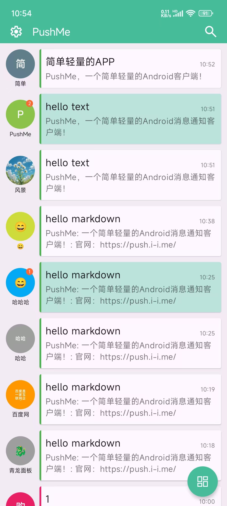</td>
    <td></td>
    <td>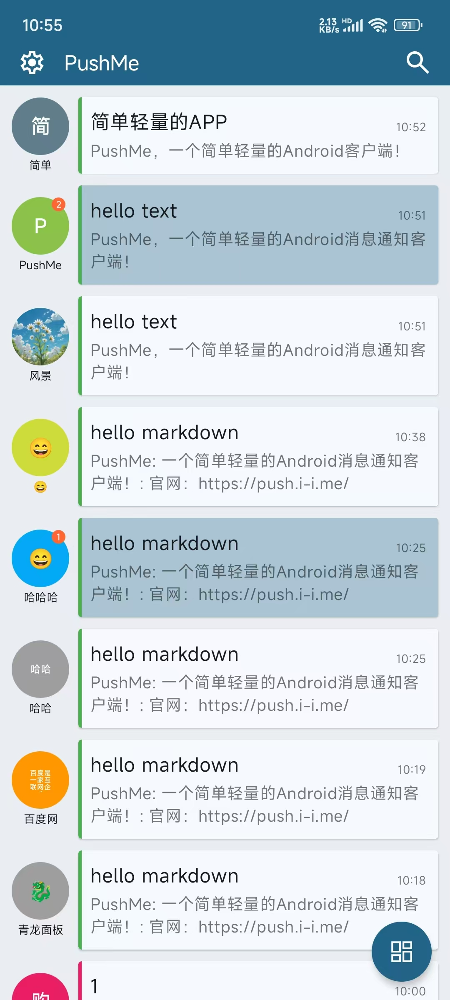</td>
    <td>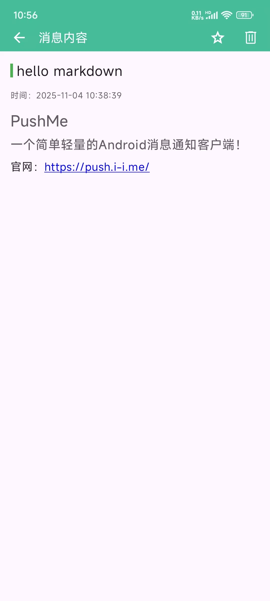</td>
  </tr>
  <tr>
    <td>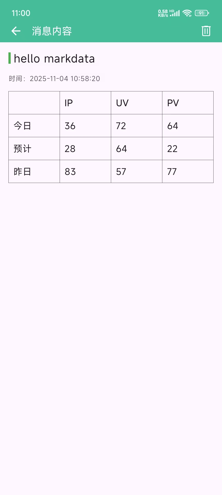</td>
    <td>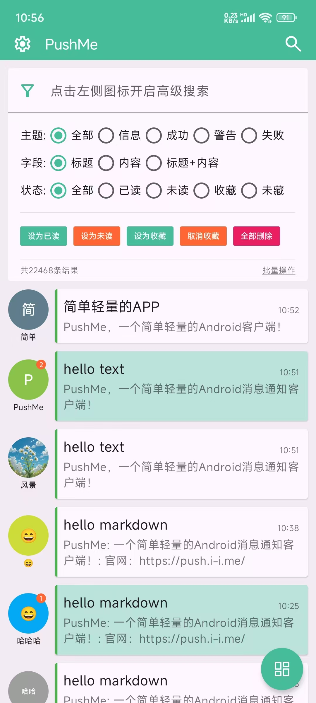</td>
    <td>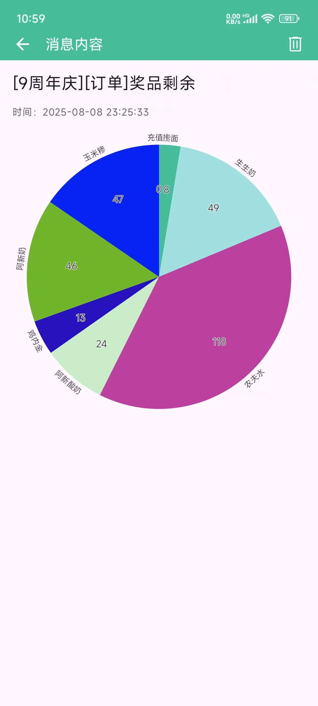</td>
    <td>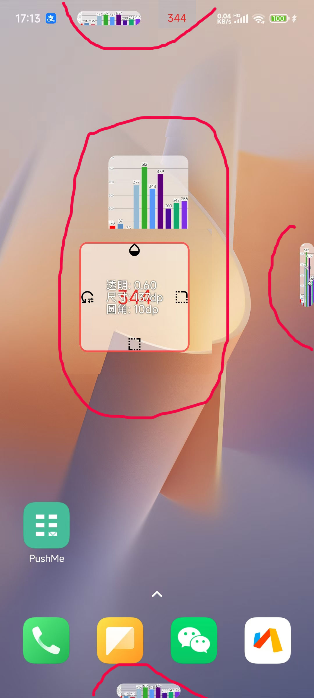</td>
  </tr>
  <tr>
    <td></td>
    <td>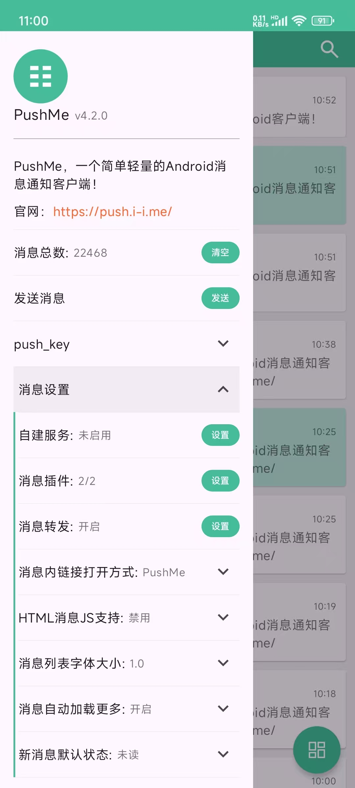</td>
    <td>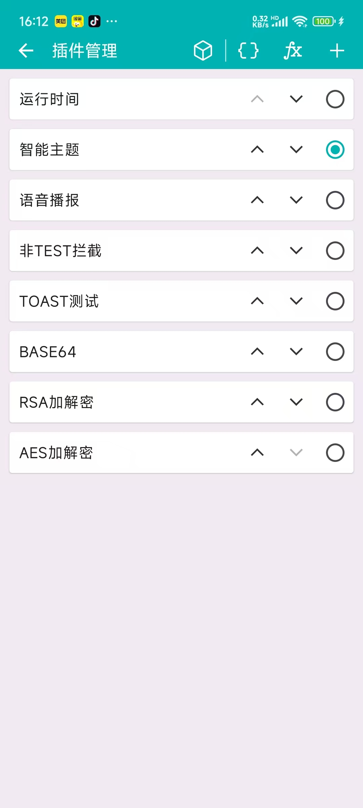</td>
    <td>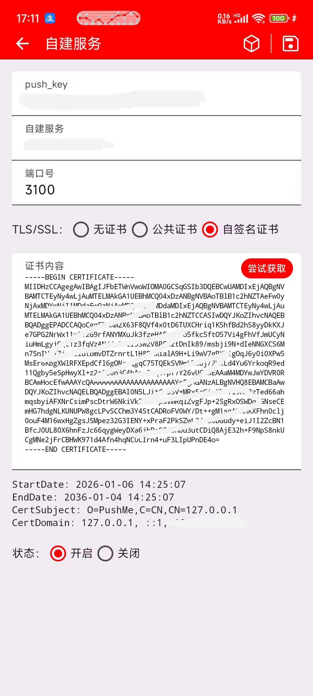</td>
  </tr>
</table>

---

## 📥 下载安装

### 系统要求

- **Android 版本**：7.0 及以上

### 下载渠道

官方构建仅通过以下渠道分发，其它来源的安装包请自行判断风险：

| 平台 | 下载地址 |
|------|----------|
| 官网 | [https://push.i-i.me](https://push.i-i.me) |
| GitHub Releases | [点击下载最新版本](https://github.com/yafoo/pushme/releases/latest) |
| Gitee（国内） | [点击下载最新版本](https://gitee.com/yafu/pushme/releases/latest) |

> ⚠️ 官方安装包使用固定签名密钥，**升级包签名必须与已安装版本一致**，否则需要先卸载旧版本（会丢失本地消息记录）。

---

## 🔧 接口文档

详细的 API 接口参数说明，请访问官方网站：

👉 [https://push.i-i.me/](https://push.i-i.me/)

### 快速上手

通过 HTTP 请求即可发送消息，**GET 或 POST 均可**：

```bash
# GET
https://push.i-i.me/?push_key=你的KEY&title=标题&content=内容

# POST
curl -d "push_key=你的KEY&title=标题&content=内容" https://push.i-i.me/
```

返回值为 `success` 表示发送成功，否则为失败原因。

### 密钥类型

PushMe 支持两种密钥，**二选一**（使用 `temp_key` 时无需传 `push_key`）：

| 密钥 | 说明 |
|------|------|
| `push_key` | 永久推送密钥，在 App 内获取，日常使用 |
| `temp_key` | 临时推送密钥，在 App 内获取，时效短 |

> ✅ **官方服务与自建服务均支持 `push_key` 和 `temp_key`**（自建服务可在 Web 管理界面的 PushKey 页面配置）。

### 消息类型

消息类型分为**通知消息**与**数据消息**两大类：

| 类别 | 类型 | 是否发出通知 | 说明 |
|------|------|:---:|------|
| **通知消息** | `text` | ✅ 会 | 纯文本，告警、提醒、任务通知等需及时感知的消息 |
| | `markdown` | ✅ 会 | Markdown 渲染（支持 GFM 表格、删除线、任务列表） |
| | `html` | ✅ 会 | 简单 HTML 渲染 |
| | `url` | ✅ 会 | 以链接卡片展示 |
| **数据消息** | `data` | ❌ 不会 | 单个数值，用于数据小屏 |
| | `markdata` | ❌ 不会 | Markdown 表格形式的多维数据 |
| | `chart` | ❌ 不会 | 轻量柱状/折线图，正文为 `类型\|尺寸::数值\|标签,...` |
| | `echarts` | ❌ 不会 | 完整 ECharts 图表，正文为 ECharts option JSON |
| | `svg` | ❌ 不会 | SVG 矢量图 |
| | `note` | ❌ 不会 | 待办清单 |

> ⚠️ **注意**：数据消息**不会发出状态栏通知**，仅用于数据展示。若需提醒用户，请使用通知消息类型。

消息标题支持 `[#标签]` 语法，用于分组、插件路由等。完整用法见 [docs/usage-guide.md](docs/usage-guide.md)。

### 兼容企业微信 / 钉钉 / 飞书

接口兼容企业微信、钉钉、飞书群机器人格式，**直接替换 URL 即可迁移**，无需改动代码。

---

## 🧩 消息插件

插件是一段 JavaScript，签名固定为：

```js
/**
 * @name 示例插件
 * @description 一句话说明
 * @dependencies PMF.toast
 */
function(msg, next) {
  // msg: { title, content, type, ... }
  // 处理完调用 next(msg) 交给下一个插件
  next(msg)
}
```

- 所有启用插件会被拼成**一个** JS 程序按洋葱模型执行：`next()` 之前按列表顺序、之后按倒序返回；不调用 `next()` 即截断后续插件。
- 可用能力通过 `PMF` 暴露（md5 / base64 / aes / rsa / toast / fetch），需在「环境变量」里开启对应开关。
- 插件可以联网并读取全部环境变量，**等同于可执行远程代码**，请只安装可信来源的插件（插件商店已限定只信任 GitHub / Gitee 两个来源 host）。

插件开发规范与示例见 [pushme-plugin 仓库](https://github.com/yafoo/pushme-plugin)。

---

## 🤖 AI 技能（Skills）

本仓库提供开箱即用的 AI Agent 技能，让 AI 助手直接帮你编写、调试 PushMe 推送代码：

| 技能 | 目录 | 说明 |
|------|------|------|
| 发送消息 | [`skill/pushme-send-message`](./skill/pushme-send-message) | 完整的接口用法、密钥说明、消息类型选择指引与排查手册 |

技能遵循 Agent Skills 规范（`SKILL.md`）。将 `skill/pushme-send-message` 复制到你的技能目录即可使用，例如：

```bash
# WorkBuddy / 通用项目级技能目录
cp -r skill/pushme-send-message .workbuddy-ai/skills/

# Claude Code
cp -r skill/pushme-send-message .claude/skills/
```

> 💡 技能内置了「通知消息 vs 数据消息」的判断规则——数据消息不弹通知，选错会导致消息静默无提示。

---

## 🛠️ 从源码构建

### 环境要求

| 项 | 版本 |
|---|---|
| JDK | 17（`compileOptions` / `jvmTarget` 均为 17） |
| Android SDK Platform | 35 |
| Android Build-Tools | 35.0.0 |
| Gradle | 8.13（使用仓库自带 wrapper，无需单独安装） |
| AGP | 8.10.1 |

### 步骤

```bash
git clone https://github.com/yafoo/pushme.git
cd pushme

# 指向本机 Android SDK
echo "sdk.dir=/path/to/Android/Sdk" > local.properties

# Debug 构建
./gradlew assembleDebug
# 产物：app/build/outputs/apk/debug/app-debug.apk
```

Windows 下使用 `gradlew.bat`。若 JDK 不是 17，可显式指定：

```bash
./gradlew assembleDebug -Dorg.gradle.java.home="C:/Program Files/Android/Android Studio/jbr"
```

### 关于 release 构建

`release` 已开启 `minifyEnabled` 与 `shrinkResources`。仓库**不包含签名配置**，直接 `assembleRelease` 会使用 debug 签名；正式分发请自行在 `app/build.gradle` 中添加 `signingConfigs`，并把 keystore 与口令排除在版本控制之外（`.gitignore` 已忽略 `*.jks` / `*.keystore` / `keystore.properties`）。

### 关于依赖仓库

`settings.gradle` 中配置了阿里云镜像（国内加速）。海外网络环境可以删除这几个 `maven { url 'https://maven.aliyun.com/...' }`，只保留 `google()` 与 `mavenCentral()`。

---

## 🏠 自建服务器

客户端开源，官方服务端不开源，但客户端可以指向自建服务。自建需要实现客户端调用的 HTTP 接口（`/client/get_host`、`/client/push_key`、`/client/get_version` 等）并部署 MQTT broker，接口清单整理中（见 `docs/`）。

MQTT 地址与端口可在应用设置中手动填写；若服务端返回的地址与本地配置冲突，以服务端下发为准。

---

## 🔐 权限说明

应用申请的权限较多，逐条说明用途，便于审计：

| 权限 | 用途 |
|---|---|
| `INTERNET` | 连接 MQTT 服务器、调用 HTTP 接口、下载插件与应用更新 |
| `ACCESS_NETWORK_STATE` / `CHANGE_NETWORK_STATE` | 监听网络变化，断网后自动重连 |
| `POST_NOTIFICATIONS` | 展示消息通知（Android 13+ 需运行时授权） |
| `FOREGROUND_SERVICE` / `FOREGROUND_SERVICE_CONNECTED_DEVICE` | 以前台服务维持 MQTT 长连接，避免被系统冻结 |
| `WAKE_LOCK` | 保持连接期间的 CPU 唤醒 |
| `RECEIVE_BOOT_COMPLETED` | 开机自启，恢复长连接与定时任务 |
| `VIBRATE` | 新消息振动提醒 |
| `SYSTEM_ALERT_WINDOW` | 悬浮窗消息 |
| `SCHEDULE_EXACT_ALARM` / `USE_EXACT_ALARM` | 定时任务按 cron 精确触发 |
| `REQUEST_IGNORE_BATTERY_OPTIMIZATIONS` | 引导用户关闭电池优化，减少后台被杀 |
| `REQUEST_INSTALL_PACKAGES` | 应用内下载更新后调起安装 |
| `BIND_NOTIFICATION_LISTENER_SERVICE` | 通知监听转发（需用户在系统设置中手动授权） |

**通知监听权限的边界**：只有用户主动开启「通知转发」后，应用才会读取通知并转发到**用户自己配置的服务器**；关闭该开关后不再读取。详见下方「隐私」。

---

## ⚙️ 手机权限设置指南

> ⚠️ **重要提示**：由于 Android 系统对后台应用的严格管理，为确保消息能及时送达，请按照以下步骤配置应用权限。

### 快速设置

在 PushMe 应用中，进入 **`权限设置`** 页面，可快速跳转至相关设置项。

### 详细配置步骤

#### 1️⃣ 基础权限配置

- ✅ **自启动权限**：允许应用开机自启
- ✅ **后台运行权限**：允许应用在后台持续运行
- ✅ **通知权限**：允许发送和显示通知
- ✅ **电池优化豁免**：设置为"允许后台高耗电"（实际功耗很低）

#### 2️⃣ 系统特定配置

##### Android 12 用户
- 🔔 必须开启 **闹钟（Alarm）权限**

##### 多任务锁定（推荐）
- 📌 在多任务页面长按 PushMe，选择"锁定"或点击锁图标
- 锁定后可安全清理其他后台应用

##### 网络优化设置
- 🌐 部分机型需关闭"后台网络优化"或"智能网络加速"
- 防止系统在息屏后切断网络连接

---

## 📱 各品牌系统适配说明

### 🟢 Vivo - OriginOS 3

**问题**：睡眠模式会导致后台被杀

**解决方案**：
```
设置 → 电池管理 → 更多设置 → 睡眠模式 → 关闭
```

**注意事项**：
- ⚠️ 关闭睡眠模式后，夜间其他应用（如微信、今日头条）可能会增加耗电
- 建议权衡消息及时性与电量消耗

---

### 🟢 Xiaomi - MIUI 14

**解决方案**：
```
1. 打开多任务页面
2. 长按 PushMe 应用卡片
3. 点击"锁定"按钮（锁图标）
4. 锁定后即可正常清理其他应用
```

---

### 🔴 Huawei - HarmonyOS 2

**现状**：经实测，HarmonyOS 2 无法保证应用稳定后台运行

**建议**：
- 尝试上述所有权限设置
- 如仍无法解决，可能需要考虑升级系统或使用其他设备

---

### 📋 其他系统

其他品牌系统暂未进行详细测试，欢迎反馈遇到的问题。

**通用建议**：
1. 给予应用最大权限（自启动、后台运行、通知）
2. 关闭电池优化
3. 在多任务页面锁定应用
4. 关闭后台网络优化

---

## 💡 使用技巧

### 保持服务在线的最佳实践

1. **完成上述权限设置**
2. **开启 StateChannel 通知**
   - 位置：PushMe 左上角设置菜单
   - 作用：实时监控服务连接状态
   - 如不需要可在设置中关闭

3. **清理后台时的正确操作**
   - 完成权限设置和多任务锁定后
   - 可以安全地从多任务页面划掉 PushMe
   - 服务会继续在后台运行

---

## 🛡️ 隐私

**不集成任何统计、广告或崩溃上报 SDK。**

应用与网络相关的行为只有以下几类：

1. **消息收发**：消息内容经由你配置的 MQTT 服务器传输。使用官方服务时，消息会经过 `push.i-i.me`。
2. **设备信息**：注册推送密钥与检查更新时，会上报设备品牌（`Build.BRAND`）、系统版本（`Build.VERSION.RELEASE`）、电池优化状态，用于服务端兼容性判断与问题排查。不上报 IMEI、MAC、位置、通讯录等。
3. **通知监听**：仅在你开启「通知转发」后读取通知内容，并按你的规则转发到你自己配置的地址。
4. **本地存储**：推送密钥、消息记录、插件、定时任务保存在应用私有目录（Room + DataStore），不主动上传。

卸载应用即清除以上全部本地数据。

---

## 📦 第三方组件

本项目使用了若干开源组件，其中 `app/src/main/java/com/android/pushme/richtext/` 目录的代码派生自 [compose-richtext](https://github.com/halilozercan/compose-richtext)（Apache-2.0，Copyright 2025 Halil Ozercan），已做包名与模块裁剪等修改。

完整清单、版权声明与协议见根目录 [NOTICE](NOTICE)，以及：

- [app/src/main/java/com/android/pushme/richtext/NOTICE](app/src/main/java/com/android/pushme/richtext/NOTICE)（派生代码说明）
- [app/libs/README.md](app/libs/README.md)（本地二进制依赖）

---

## 📄 协议

本项目基于 **Apache License 2.0** 发布，全文见 [LICENSE](LICENSE)。

```
Copyright 2023-2026 yafu

Licensed under the Apache License, Version 2.0 (the "License");
you may not use this file except in compliance with the License.
You may obtain a copy of the License at

    http://www.apache.org/licenses/LICENSE-2.0
```

**商标与品牌**：Apache-2.0 不授予商标权。「PushMe」名称、应用图标、`push.i-i.me` 域名及官方服务标识不随代码授权。基于本代码的二次分发请使用不同的应用名称与图标，避免与官方版本混淆。

**贡献**：除非另有说明，你提交的 Pull Request 将按 Apache-2.0 授权（见协议第 5 条）。

---

## ⚖️ 免责声明

本项目仅供个人学习与自用。使用通知监听、开机自启、后台常驻等能力时，请遵守所在地区的法律法规与目标应用的服务条款。作者不对因使用本软件产生的任何直接或间接损失负责。

---

## 📞 获取帮助

### 官方渠道

- 🌐 **官方网站**：[https://push.i-i.me/](https://push.i-i.me/)
- 📢 **Telegram 频道**：[https://t.me/pushme_channel](https://t.me/pushme_channel)
- 💬 **问题反馈**：[GitHub Issues](https://github.com/yafoo/pushme/issues)
- 🧩 **插件仓库**：[https://github.com/yafoo/pushme-plugin](https://github.com/yafoo/pushme-plugin)
- 💬 **微信交流群**：

  

### 常见问题

**Q: 为什么收不到消息推送？**  
A: 请检查是否完成了所有权限设置，特别是电池优化和多任务锁定。

**Q: 应用耗电严重吗？**  
A: 实际测试显示功耗很低，"允许后台高耗电"只是防止系统杀进程的设置，并非真的耗电。

**Q: 可以自己部署服务端吗？**  
A: 可以，PushMe 支持私有化部署，具体方法请参考官网文档与上方「自建服务器」一节。

**Q: 自己编译的包能覆盖安装官方版吗？**  
A: 不能。签名不同，必须卸载官方版再装（会丢失本地消息记录）。

---

## 🙏 致谢

- [compose-richtext](https://github.com/halilozercan/compose-richtext) — Markdown 与富文本渲染
- [QuickJS-Android](https://github.com/taoweiji/quickjs-android) — 插件引擎
- [Apache ECharts](https://echarts.apache.org/) — 图表渲染
- [Eclipse Paho](https://github.com/eclipse-paho/paho.mqtt.java) — MQTT 客户端
- [commonmark-java](https://github.com/commonmark/commonmark-java) — Markdown 解析
- 以及 AndroidX、Compose、OkHttp、Gson、Coil、XXPermissions、compose-color-picker 等项目的作者

---

<p align="center">
  <sub>Made with ❤️ by <a href="https://github.com/yafoo">yafoo</a></sub>
</p>
